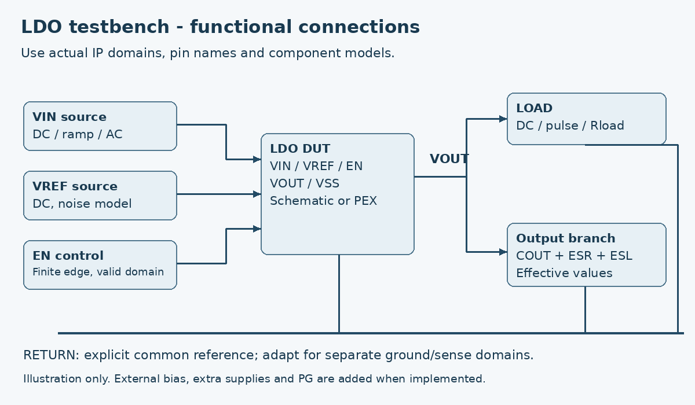
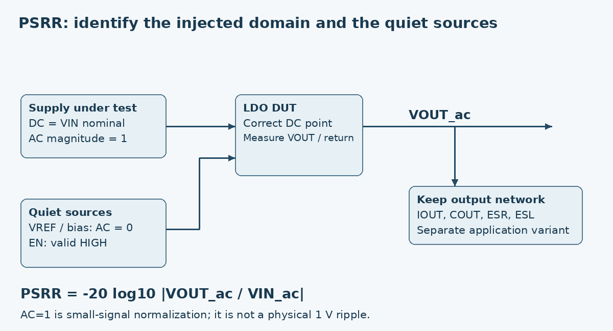
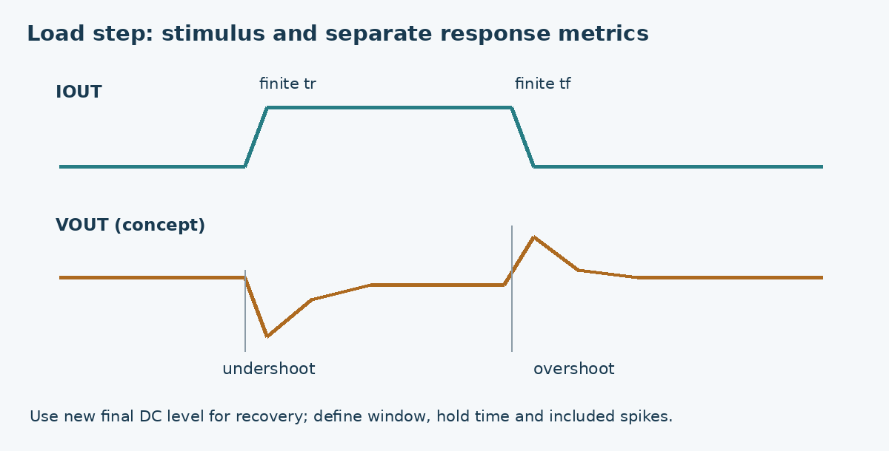

# LDO - методика характеризации в Virtuoso / ADE L/XL

Редакция 2.0, 2026-10-26. Применяется вместе с datasheet; это инженерная инструкция к измерениям. Ни один приведённый пример настройки или критерий сам по себе не является спецификацией вашего процесса.

## 1. Инструменты и границы применения

Virtuoso задаёт schematic/testbench/config. ADE L/XL управляет анализами, параметрами и результатами; расчёт делает simulator. В рецептах принят Spectre, поскольку simulator в запросе не назван. Перед запуском проверить simulator и его версию. Для другого solver сопоставить анализы и результатные функции.

ADE L удобно использовать для отладки одного теста, operating point, sweep и выражений Calculator. В типичном ADE L анализ выбирается через Analyses -> Choose; в ADE XL - внутри настройки соответствующего test. Точные подписи форм зависят от версии: здесь описаны устойчивые понятия, а не обещан одинаковый GUI для всех релизов.

ADE XL хранит несколько tests, corners, design variables, outputs/specs; Monte Carlo требует поддержанных статистических моделей PDK и соответствующих возможностей установки. Наличие GUI не создаёт отсутствующие device/statistics/noise models.

Calibre DRC/LVS проверяют геометрию/соответствие в рамках своих deck; Calibre PEX извлекает заданные паразитики. PERC deck отсутствует: автоматический PERC не выполнен. Если electrical checks встроены в доступный DRC/LVS deck, перечислить конкретно их покрытие; не предполагать самостоятельный ERC deck.

Liberate нужен для согласованной digital library characterization и Liberty timing/power моделей. Analog DC/AC/noise/stability/transient параметры LDO измеряются в ADE/Spectre. Liberate AMS - отдельное решение; не считать его доступным только потому, что установлен Liberate.

## 2. Подготовка одного воспроизводимого testbench

1. Создать отдельную testbench cell/view. DUT подключить через symbol/config; прописать top, pin mapping и реальную schematic revision.
2. Поставить analogLib источники supply, reference/bias и нагрузку. Для каждого указать направление тока и return; именовать VIN, VOUT, VREF, VSS и дополнительные domains.
3. Ввести design variables: vin_dc, vref_dc, ibias_dc при необходимости, i_load, c_out, r_esr, l_esl, t_en, tr_en, tr_load, tf_load. Имена - соглашение проекта, не встроенные переменные ADE.
4. Подключить model files и model sections PDK; temperature и supply values записать явно. Не подменять поддержку HV/LDMOS обычной core MOS моделью.
5. Проверить dc operating point: voltages/currents, корректность bias, отсутствие непредусмотренных forward-biased junctions, правильный feedback sign и включённый режим. Регион MOS анализируется по назначению: pass device в dropout может быть в triode, универсальное «все MOS saturation» неверно.
6. Настроить нужный анализ, сохраняемые узлы и currents, корректные output expressions. Определить время установления до окна измерения.
7. Сначала один nominal run, визуальная проверка waveform и ручная сверка метрики; затем sweeps/corners. Для transient проверить, что уменьшение maxstep не меняет нужный результат существенно относительно принятого допуска.
8. Сохранить ADE state, schematic/config revision, netlist, model sections, simulator options/version, extraction context, input parameters, results и measurement window под Run ID.

Рисунок - собственная функциональная иллюстрация, не netlist и не результат симуляции. VREF/bias/domain-specific источники адаптируются к реальной реализации.

## 3. PVT, sweeps и статистика

P = process model section; V = все применимые supplies/reference/bias; T = model temperature. Дополнительно зависят load, C/ESR/ESL, code и mode. FF/SS нельзя заранее объявить worst corner для любого параметра: максимум IQ, минимум PM и худший dropout могут возникнуть в разных местах.

- Сначала TT/номинал для проверки теста, затем corners и extrema компонентов/нагрузки. Указать, какие промежуточные значения и комбинации были проверены.
- Использовать только реальные model sections конкретного PDK. TT/SS/FF/SF/FS - распространённые обозначения, а не обязательный набор каждого процесса.
- При нескольких доменах явно определить, какие voltages меняются совместно, какие независимо, и какие combinations запрещены.
- Параметрический sweep по process corners не заменяет Monte Carlo. Для MC указать process/mismatch/both, sampling, seed, samples, failure criterion и уровни schematic/post-layout; разумный объём назначается целями статистики, а не универсальным числом.
- Failed/nonconverged run не удалять молча из статистики. Хранить count, причину и решение. Yield без достаточной статистики не объявлять гарантированным.

## 4. Извлечение метрик и формат результата

В ViVA/Calculator использовать доступные операции value-at-x, min/max, average, threshold crossing, integration, dB magnitude и результаты анализов. Математические формулы ниже - определения, не готовые команды OCEAN/Calculator: названия функций, waveform accessors и синтаксис семейств зависят от версии.

Для каждой метрики сохранить parameter_id, method_id, test_id, run_id, PVT/load, representation, value, unit, status и evidence. Не брать глобальный min/max всей family до проверки параметров и измерительных окон каждого run. Typ берётся из фиксированной nominal точки, а не средним всех углов.

Рекомендуемая числовая запись: value=число; unit=единица; status=measured/NC/N_A; для неизвестного в YAML value=null. В Markdown NC/N/A/— разрешены как отображение. Observed results, target specs и approved limits должны быть разными сущностями.

## 5. Карточки параметров

Каждая карточка объясняет физический смысл, setup, анализ, формулу, данные для datasheet и типичную ошибку. Общие критерии вроде 2%/hold time - примеры методики; владелец IP должен назначить их перед реальными измерениями.

## M01. Рабочие питания и температура

**Смысл:** VIN питает силовой путь; AVDD и DVDD могут питать аналоговую часть и интерфейс отдельно. Рабочий диапазон означает выполнение всех нужных характеристик, а не просто наличие VOUT.

**Что зафиксировать:** Фиксировать reference/bias, нагрузку, конфигурацию и модель внешних компонентов. Для независимых доменов явно задать разрешённые сочетания напряжений.

**Как измерить в ADE:** В ADE задать источники analogLib параметрами vin_dc, avdd_dc, dvdd_dc, temp. Сначала dc operating point, затем DC/parametric sweep и выбранные tran tests на краях диапазона.

**Метрика:** В каждой точке проверить набор спецификаций: VOUT, ток, состояние защиты/PG, запуск. Минимальное VIN не определять одним визуальным наблюдением.

**Что занести в datasheet:** Таблица разрешённых сочетаний supply, process sections, TJ, нагрузка; ссылки на tests. Absolute maximum ratings - отдельный документированный предел.

**Проверка ошибки:** Не смешивать температуру моделей TJ с ambient. Не комбинировать произвольные независимые PDK sections, если PDK требует согласованного набора.

## M02. Внешний reference: уровень, чувствительность, импеданс

**Смысл:** Reference задаёт масштаб выходного напряжения. Для LDO с feedback factor beta в первом приближении VOUT = VREF/beta; ошибка и шум reference могут передаваться на выход.

**Что зафиксировать:** Задать VIN, IOUT, code, TJ. Для базовой метрики использовать идеальный VREF, а влияние реального reference проверять отдельным сценарием.

**Как измерить в ADE:** DC sweep VREF в разрешённом диапазоне; измерить VOUT и ток порта VREF. Затем добавить последовательный R и при необходимости реальную модель reference. AC=1 на VREF при AC=0 на остальных источниках даёт передаточную функцию reference-to-output.

**Метрика:** Чувствительность: delta(VOUT)/delta(VREF), V/V. Проверить ток и полярность входа VREF, ошибку от source impedance и время установления.

**Что занести в datasheet:** VREF nominal/range, ток порта, допустимый source impedance, режим запуска, ограничения шума и путь возврата REF_GND.

**Проверка ошибки:** Идеальный источник скрывает нагрузку на Bandgap. Точность самого LDO при идеальном VREF не равна точности системы с реальным reference.

## M03. Bias current и compliance

**Смысл:** Внешний bias current задаёт токи внутренних каскадов. Compliance - область напряжений bias-порта, в которой требуемый ток действительно обеспечивается источником и корректно принимается блоком.

**Что зафиксировать:** Уточнить, ожидает IP ток от PMOS, ток в NMOS, replica connection или отдельную bias cell. Направление и требуемая топология должны соответствовать реальному интерфейсу.

**Как измерить в ADE:** Использовать рекомендованную bias cell или её согласованную модель; sweep bias magnitude и supply/PVT. Для compliance менять напряжение порта в отдельном testbench с корректной моделью источника, наблюдая реальный ток и device operating points.

**Метрика:** Зафиксировать диапазон тока и напряжения, в котором сохраняются установленная погрешность bias и функциональные характеристики. Допуск задаётся спецификацией, не выбирается произвольно исполнителем.

**Что занести в datasheet:** Ток/направление, модель источника, compliance range, опорная земля, PVT и токовое потребление источника отдельно от IP.

**Проверка ошибки:** Идеальный isource с неограниченным compliance может показать успех при физически невозможном напряжении. Для IP без внешнего bias этот пункт N/A.

## M04. Диапазон VOUT, коды и trim

**Смысл:** Диапазон семейства, выход одной fixed-версии и runtime programming - разные свойства. Шаг кода - изменение установившегося VOUT между соседними кодами, а не автоматически точность.

**Что зафиксировать:** Фиксировать VIN с достаточным headroom, VREF/bias, IOUT и COUT. Входы кода задавать в правильном DVDD domain.

**Как измерить в ADE:** Для каждого допустимого кода запустить DC или установившийся tran. В ADE XL оформить code как design variable/sweep; цифровые уровни сформировать источниками или согласованным decoder, а не считать integer напрямую напряжением pin.

**Метрика:** Таблица code -> VOUT; deltaV_code = VOUT[k+1] - VOUT[k]. Проверить monotonicity и допустимые переходы отдельно. Для trim описать selection procedure и до/после trim.

**Что занести в datasheet:** Default/reset code, диапазон, шаги, тип rounding/selection, запрещённые коды, результаты PVT и доступность runtime update.

**Проверка ошибки:** Не применять INL/DNL определения без согласованной transfer convention. В fixed LDO кодовая часть N/A.

## M05. Точность выходного напряжения

**Смысл:** Показывает отклонение установившегося выхода от заданного целевого значения. Общая accuracy может включать process, voltage, temperature, load, reference и trim - это надо перечислить.

**Что зафиксировать:** В каждой точке определить VOUT_target для текущего code/варианта. Указать, включена ли ошибка внешнего reference и bias.

**Как измерить в ADE:** DC operating point по PVT/load/codes. Для режимов без корректной DC точки использовать установившийся tran и среднее на определённом окне.

**Метрика:** error_percent = 100 * (VOUT - VOUT_target)/VOUT_target. Сохранить signed min/max error; для симметричной спецификации также max(abs(error_percent)).

**Что занести в datasheet:** Проценты и при необходимости mV; область PVT/load, fixed или ideal reference, representation, untrimmed/trimmed.

**Проверка ошибки:** Не подменять accuracy одним line/load sweep. Extremes из конечной сетки и статистическая гарантия - разные утверждения.

## M06. Line regulation

**Смысл:** Насколько меняется DC VOUT при изменении входного питания. Это статическая чувствительность, отличная от transient response и PSRR.

**Что зафиксировать:** Фиксировать IOUT, VREF/bias, TJ, process, code. Обе крайние точки должны оставаться в режиме regulation, а не dropout/current limit.

**Как измерить в ADE:** DC sweep VIN между VIN1 и VIN2. В ViVA/Calculator взять VOUT на концах и максимум/минимум sweep; проверить форму кривой.

**Метрика:** Absolute endpoint change = abs(VOUT(VIN2)-VOUT(VIN1)), mV. Normalized = это изменение / (VIN2-VIN1), mV/V. Если спецификация задаёт размах по sweep, использовать max(VOUT)-min(VOUT) и назвать именно так.

**Что занести в datasheet:** Один явно выбранный метод и единицы, VIN1/VIN2, нагрузка, углы и кривая VOUT(VIN).

**Проверка ошибки:** В приложенных datasheet line regulation дана в mV для определённого deltaVIN; нельзя переписать те же числа как mV/V без нормирования.

## M07. Load regulation

**Смысл:** Изменение DC VOUT при изменении установившегося тока нагрузки. Включает конечное усиление петли и, в зависимости от точки sense, IR drop пути.

**Что зафиксировать:** Фиксировать VIN/headroom, reference/bias, TJ и code. Задать измерение на macro pin или на внешней нагрузке; при remote sense указать оба узла.

**Как измерить в ADE:** DC sweep тока нагрузки от I1 до I2. Источник тока направить от VOUT к return и сохранить знак; дополнительно посмотреть operating points.

**Метрика:** Absolute = abs(VOUT(I2)-VOUT(I1)), mV, либо размах sweep при таком определении. Normalized = абсолютное изменение / (I2-I1), mV/mA. Метод фиксируется заранее.

**Что занести в datasheet:** I1/I2, VIN, точки VOUT/VFB, результат в mV и/или mV/mA с точным названием, DC curve.

**Проверка ошибки:** Не путать с undershoot при быстром load step. Идеальный current sink при VOUT около нуля может форсировать нефизический режим; проверить нагрузочную модель.

## M08. Dropout voltage

**Смысл:** Недостаточный headroom ограничивает способность LDO поддерживать VOUT. Dropout измеряется по явно выбранной величине падения относительно регулируемого baseline.

**Что зафиксировать:** Выбрать один criterion, например 2% от VOUT_base; это проектная методика, а не универсальное правило. Фиксировать IOUT, VREF, bias, code, TJ и process.

**Как измерить в ADE:** Сначала получить VOUT_base при VIN_hi с уверенным regulation. Затем DC sweep VIN вниз. Найти первое при снижении VIN пересечение VOUT = 0.98*VOUT_base; уточнить шаг/интерполяцию. Если DC не описывает состояние, подтвердить медленным tran sweep.

**Метрика:** VDO = VIN_at_cross - VOUT_at_cross. Дополнительно можно сообщить требуемый VIN для абсолютной output-accuracy, но это другой критерий.

**Что занести в datasheet:** Criterion, VIN_hi, IOUT/PVT, VDO(load), ограничения отдельных AVDD/DVDD. Специальный sweep ниже recommended VIN не расширяет рабочую область.

**Проверка ошибки:** Не считать VIN минус номинальные 1.2 V без проверки реального VOUT. UVLO, reference failure или другой защитный режим могут прервать sweep раньше dropout.

## M09. PSRR

**Смысл:** Показывает, насколько малая переменная помеха заданного питающего домена проходит на выход. При принятом положительном знаке больше dB означает лучшее подавление.

**Что зафиксировать:** Сначала правильная DC точка; указать VIN, VOUT/headroom, IOUT, COUT/ESR/ESL, reference/bias. Каждый независимый supply проверять отдельно.

**Как измерить в ADE:** В ADE выбрать AC. В источнике исследуемого питания задать DC=VIN и AC magnitude=1, phase=0; остальные независимые AC stimuli=0. EN держать в valid HIGH. Выполнить logarithmic frequency sweep; вывести transfer VOUT_ac/VIN_ac.

**Метрика:** PSRR_dB = -20*log10(abs(VOUT_ac/VIN_ac)). AC=1 - нормировка linear small-signal модели, а не физическая большая пульсация 1 V. Для графика источники/узлы измерения должны быть определены.

**Что занести в datasheet:** Кривая по frequency и табличные точки, например 1 kHz/100 kHz/1 MHz по требованиям, с PVT/load/headroom и полярностью dB.

**Проверка ошибки:** Если EN/VREF привязаны к возмущённому VIN, это меняет transfer. Для intrinsic supply rejection держать их AC quiet, для application PSRR повторить реальную схему связи. DC/DC switching требует другой методики.

## M10. Спектральная плотность и интегральный шум

**Смысл:** ASD e_n(f) имеет единицы V/sqrt(Hz), PSD S_v(f) - V^2/Hz; integrated output noise имеет единицы Vrms и зависит от полосы. Это три разных представления.

**Что зафиксировать:** Задать DC point, load, COUT/ESR/ESL и шумовые модели. Отдельно указать, идеален ли внешний reference и включён ли шум питания/reference/bias.

**Как измерить в ADE:** В ADE выбрать noise, задать output pair VOUT/return и sweep frequency. Если форма требует input source для input-referred результата, использовать корректный выбранный источник; для datasheet брать output-referred результат. Проверить реальные единицы вывода ViVA.

**Метрика:** Vnoise_rms = sqrt(integral(S_v(f), f1..f2)) = sqrt(integral(e_n(f)^2, f1..f2)). Если ViVA уже выдаёт integrated Vrms, повторно квадрат/корень не применять.

**Что занести в datasheet:** ASD в заданной frequency, например 30 kHz, и/или Vrms в заданной полосе; output node, включённые источники, модель и run.

**Проверка ошибки:** У SGC77 приведён noise density на одной частоте; из него нельзя получить готовое Vrms без спектра. Без шумовой модели паразитного/поведенческого элемента итог может быть неполным.

## M11. Startup, rise time и soft-start

**Смысл:** Время от события запуска до результата, время нарастания 10-90% и закон ограничения стартового тока описывают разные аспекты включения.

**Что зафиксировать:** Развести EN startup при уже стабильных supply/reference и power-ramp startup. Задать finite edge, нагрузку, COUT, начальный заряд, порядок питания и bias readiness.

**Как измерить в ADE:** Tran: сначала EN=0; после установления VIN/VREF включить EN. Отдельный tran запускает supply ramp с заданной скоростью. Сохранить EN, VIN, VREF, VOUT и все supply currents.

**Метрика:** t_rise = t90(VOUT)-t10(VOUT). t_start_settle = t_enter_window - t_EN50; окно, например ±2% от final value, должно удерживаться заданное время. Также записать inrush peak и reference readiness.

**Что занести в datasheet:** Условие trigger, окно/hold time, load/COUT, supply ramp, peak current, over/undershoot. Soft-start profile не сводить к одному t10-90.

**Проверка ошибки:** В SGC77 строка tsettling содержит критерий 10-90%; в собственном документе называть такой результат rise time, а для settling задавать окно и удержание. Начальная DC точка может скрыть запуск: явно проверить initial condition и не принимать DC-start как power-ramp test.

## M12. Установление после изменения code/setpoint

**Смысл:** Это динамическая реакция на новое целевое напряжение. Она отличается от startup и от статического шага DAC.

**Что зафиксировать:** Фиксировать начальный и конечный code/VOUT_target, supply/headroom, IOUT/COUT и способ обновления bus.

**Как измерить в ADE:** Tran: дать установиться начальному режиму; переключить code или reference с заданным фронтом; записать input controls и VOUT. Повторить переход вверх и вниз; при реальной последовательной записи моделировать её.

**Метрика:** t_settle = время от принятия нового кода до непрерывного нахождения в окне final target ±epsilon в течение hold_time. t10-90 и glitch peak сообщать отдельно.

**Что занести в datasheet:** Code1/code2, момент trigger, величина шага, epsilon/hold_time, over/undershoot и waveform.

**Проверка ошибки:** Для down-step LDO без sink/discharge время может определяться нагрузкой, а не GBW усилителя. Для fixed-версии без изменения setpoint пункт N/A.

## M13. Load transient: undershoot, overshoot, recovery

**Смысл:** Быстрое увеличение тока временно просаживает выход; уменьшение может вызвать выброс. Амплитуда и время восстановления зависят от петли и R/L/C окружения.

**Что зафиксировать:** IOUT low/high, rise/fall time, repetition/hold time, VIN/headroom, PVT, COUT/ESR/ESL, R/L силового пути и sense topology.

**Как измерить в ADE:** Tran с pulse/PWL current load. Дать установить low load, перейти к high, дождаться установления, затем обратно. Использовать конечные фронты и save/maxstep, достаточные для формы отклика; проверить с уменьшенным maxstep.

**Метрика:** Undershoot = Vpre_low - min(VOUT) после upward current step; overshoot = max(VOUT) - Vpre_high после downward step. Recovery измерять относительно нового final DC уровня с заданным окном и hold time; steady load error учитывать отдельно.

**Что занести в datasheet:** Два направления, исходные/конечные уровни, амплитуда, recovery, окна анализа и waveform VOUT/IOUT. Уточнить, включён ли мгновенный ESR/ESL spike.

**Проверка ошибки:** Не обрезать начало события, чтобы улучшить число. Идеальный нулевой фронт с ESL даёт непрактичный spike. Если входное питание идеальное, не заявлять результат для произвольного package/PDN.

## M14. Line transient

**Смысл:** Реакция на конечный скачок входного питания. Это large-signal time-domain тест, не DC line regulation и не AC PSRR.

**Что зафиксировать:** Задать VIN low/high, edge times, IOUT/COUT и поведение EN/reference/bias при изменении VIN.

**Как измерить в ADE:** Tran с pulse/PWL supply. Проверить оба направления; реальные связанные домены изменять по выбранному application сценарию, а не автоматически оставлять постоянными.

**Метрика:** Пиковое отклонение относительно предшествующего уровня и recovery к новому final value с заданным окном; проверить отсутствие защиты/срыва.

**Что занести в datasheet:** Supply waveform, изменение VOUT, критерий recovery, PVT/headroom и уровень модели соединений.

**Проверка ошибки:** Медленный ramp и быстрый фронт проверяют разные эффекты. Отдельное идеальное VREF показывает один сценарий, реальный reference может ухудшить системный отклик.

## M15. Устойчивость, loop bandwidth, phase/gain margin

**Смысл:** LDO - замкнутая петля. Phase margin и gain margin характеризуют её small-signal поведение около заданной рабочей точки; выходные C/ESR и нагрузка меняют полюса/нули.

**Что зафиксировать:** Выбрать корректную петлю и согласованный probe point; сохранить DC operating point, loading и все внешние компоненты. Если есть inner current loop, CMFB или другие петли, их нельзя считать проверенными одним числом.

**Как измерить в ADE:** В измерительной копии schematic поставить analogLib iprobe в согласованной ветви feedback, выбрать STB и instance probe. Выполнить frequency sweep и вывести loopGain, phase margin/gain margin через доступные результаты STB. Сопоставить OP с исходной схемой.

**Метрика:** Bandwidth loop - frequency выбранного 0 dB crossing; margin использовать из корректной convention simulator. При нескольких пересечениях оценить все применимые crossing/общую устойчивость; требуемый предел задаёт проект.

**Что занести в datasheet:** LoopGain magnitude/phase, probe instance/location, PM/GM/crossing, PVT, load и COUT/ESR/ESL, а также small/large-signal transient confirmation.

**Проверка ошибки:** iprobe не является буквальным разрывом, меняющим loading; STB использует специальную инжекцию при сохранённой схеме. Если внутренний feedback недоступен в PEX macro, нужен согласованный instrumented view, а не произвольная правка release netlist.

## M16. IQ и токи отдельных доменов

**Смысл:** IQ - потребление в заданном режиме, обычно без внешней нагрузки. Многодоменный IP может потреблять IVIN, IAVDD, IDVDD и bias/reference currents отдельно.

**Что зафиксировать:** Задать EN/mode, load, input levels и reference/bias. Определить знак тока как положительный ток, входящий в IP из каждого источника.

**Как измерить в ADE:** DC operating point либо среднее установившегося tran. В ADE сохранить currents питающих источников и проверить их sign convention на простом режиме. Измерить no-load и нужные loaded точки отдельно.

**Метрика:** Отчёт по каждому домену. Для системы считать P_in = sum(Vdomain*I_into_domain), без двойного учёта. На общей шине можно отдельно определить residual supply current, но только с учётом всех соединённых ветвей.

**Что занести в datasheet:** Режим, load, supplies, reference/bias included/excluded, ток каждого домена и суммарная мощность при разных voltages.

**Проверка ошибки:** Нельзя просто сложить токи разных напряжений и назвать результат потреблением мощности. Если VIN=AVDD одним источником, его ток уже включает обе ветви.

## M17. Shutdown current / leakage

**Смысл:** Потребление при выключенном IP зависит от уровней остальных входов, температур и наличия внешнего заряда/питания на выходе.

**Что зафиксировать:** EN=off; задать все supplies, code/test pins, VREF/bias и состояние VOUT. Отдельно задать, остаётся ли reference включённым.

**Как измерить в ADE:** DC или долгий tran после завершения разряда. Сохранить токи всех питающих и сигнальных портов. Сценарий externally driven output выполнять только если такой режим разрешён.

**Метрика:** ISHDN по доменам и power. Ток разряда COUT сразу после выключения не считать установившейся утечкой.

**Что занести в datasheet:** TJ, input levels, output forcing/charge state, задержка измерения после EN, включённые внешние цепи.

**Проверка ошибки:** Бесконечно малый ток без адекватных device leakage моделей не является гарантированным silicon result. Выбор произвольной температуры вместо worst allowed hot corner может скрыть максимум.

## M18. Номинальный ток, current limit и foldback

**Смысл:** IOUT_MAX - область нормальной regulation; ILIM - защитное ограничение; foldback - зависимость разрешённого тока от сниженного VOUT. Эти токи не взаимозаменяемы.

**Что зафиксировать:** Проверить наличие и тип защиты. Задать supplies, TJ, reference/bias, COUT и нагрузочную модель; limits/heat нужны по реальному процессу.

**Как измерить в ADE:** Для IOUT_MAX sweep нагрузку и проверить все спецификации. Для current limit использовать ступени/scan Rload или согласованный electronic load. Для foldback снять IOUT(VOUT) в допустимом testbench с изменением Rload или согласованным voltage clamp, затем подтвердить fault/recovery tran.

**Метрика:** Критерий выхода из regulation задаётся отдельно. На protection curve найти knee/plateau и ток в указанной low-VOUT/short condition. Если ток пульсирует/hiccup, сообщить peak, average и период, а не один DC ILIM.

**Что занести в datasheet:** IOUT_MAX, ILIM и IFOLDBACK при заданном VOUT, режим защиты, recovery, модель thermal effects либо её отсутствие.

**Проверка ошибки:** Идеальный current sink при КЗ способен увести VOUT отрицательно. Электрическая симуляция без electrothermal модели не подтверждает safe operating area или thermal protection.

## M19. Power-good thresholds, hysteresis и delays

**Смысл:** PG сообщает, что выход пересёк заданную область. Порог вверх, порог вниз, hysteresis и задержка - отдельные параметры; output type/domain должны быть указаны.

**Что зафиксировать:** Задать PG pull-up/load, его питание, reference, ramp rate и mode. Метод воздействия на sense node согласовать, чтобы не бороться идеальным источником с активным LDO.

**Как измерить в ADE:** DC/медленный tran sweep выхода через доступный sense/test interface: вверх и вниз. При отсутствии такого interface использовать согласованный testbench/изменение нагрузки. Затем отдельные faster ramps для delays. Сохранить VOUT/VFB и PG.

**Метрика:** VPG_rise, VPG_fall и hysteresis=VPG_rise-VPG_fall; в % относительно указанного target. Delay от пересечения аналогового threshold до 50% цифрового PG при заданной ramp.

**Что занести в datasheet:** Порог/единицы, polarity, hysteresis, delay, pull-up/load, supply validity и поведение при low VDD.

**Проверка ошибки:** Test mode может менять делитель/компаратор; результат normal mode подтвердить отдельно. При отсутствии PG - N/A, а не NC.

## M20. VIH/VIL, VOH/VOL, domains

**Смысл:** VIH/VIL задают допустимые входные логические уровни; observed trip point отдельного экземпляра не равен гарантированным VIH/VIL. VOH/VOL зависят от тока нагрузки выхода.

**Что зафиксировать:** Правильные DVDD/ground, PVT, input edge, допустимые off states. Для output указать push-pull/open-drain, pull-up и sink/source load.

**Как измерить в ADE:** Input: DC sweep вниз/вверх и tran конечными фронтами, наблюдая управляемую функцию. Output: DC load sweep в обоих разрешённых состояниях. Timing/drive models нужных digital arcs могут оформляться через Liberate в согласованном flow.

**Метрика:** Сохранить observed thresholds/hysteresis, VOH при заданном source current и VOL при sink current. Утверждённые VIH/VIL границы назначаются по полному analysis/review.

**Что занести в datasheet:** Уровни в V или долях названного DVDD, токи/ёмкость нагрузки, default/floating/off-state, source stage.

**Проверка ошибки:** Не переносить HIGH=0.8*DVDD из чужого datasheet в свой без проверки. PG open-drain не имеет собственного drive-high уровня без pull-up.

## M21. COUT, ESR, ESL и допустимая нагрузка

**Смысл:** COUT хранит заряд; ESR даёт resistive step/zero; ESL создаёт inductive spike и high-frequency resonance. Номинальная ёмкость детали может отличаться от effective capacitance.

**Что зафиксировать:** Задать диапазоны effective C, ESR/ESL и при необходимости package/interconnect R/L. Не включать один и тот же паразитик и в PEX, и в внешнюю модель дважды.

**Как измерить в ADE:** Параметризовать последовательные C/R/L в output branch. Sweep C/ESR/ESL совместно с load/PVT; использовать M15 для small-signal stability, M11/M13/M14 для динамики.

**Метрика:** Допустимая область - пересечение выполнения всех установленных требований по stability/transient/startup. Минимум C не определять одним устойчивым TT графиком.

**Что занести в datasheet:** Effective C range, ESR/ESL model, load, test matrix, предельные точки, link to component assumptions и PDN.

**Проверка ошибки:** Согласовать defaults с таблицей диапазонов. В SGC77 default ESR на стр. 11 и диапазон ESR на стр. 13 расходятся; для собственного блока условия должны быть внутренне согласованны.

## M22. Shutdown output: Hi-Z / discharge resistance

**Смысл:** После выключения VOUT может быть Hi-Z, разряжаться через resistor/switch или удерживаться другим способом. Это существенно для sequence и back-power.

**Что зафиксировать:** Задать EN, VOUT initial charge, load, supplies и optional disable-discharge control. Наличие discharge device должно быть подтверждено схемой.

**Как измерить в ADE:** Tran после выключения с заданным COUT/load; сохранить VOUT и discharge current. Для Rdis использовать разрешённое voltage forcing на выключенном выходе и измерить I(VOUT) либо соответствующую модель разряда.

**Метрика:** Для омической области Rdis=VOUT/Idis; для нелинейной сообщить curve/точку. Время разряда измерить между заданными уровнями. При Hi-Z учитывать leakage и load.

**Что занести в datasheet:** Состояние выхода, Rdis/curve, discharge time thresholds, COUT/load и off-supply assumptions.

**Проверка ошибки:** RC экспонента не универсальна для active current discharge. Не тестировать back-driven VOUT, если такой режим не разрешён.

## M23. Power sequencing, terminal stress и review без PERC

**Смысл:** Разные порядки питания способны открывать parasitic junctions или создавать недопустимые VGS/VGD/VDS. Функционирование и надёжность здесь связаны, но это разные критерии.

**Что зафиксировать:** Список разрешённых/запрещённых sequences и device limits согласовать с circuit/reliability owner по PDK; задать EN/VREF/bias/test pin states и finite ramps.

**Как измерить в ADE:** Tran sequences/power-off scenarios; сохранить выбранные terminal voltages/currents и operating points. Использовать только реально доступные model/assert/check features simulator. Calibre DRC/LVS сами по себе не дают полного покрытия stress/ESD.

**Метрика:** Проверить наблюдённые stresses против конкретных ограничений процесса; записать покрытые devices, states, временныe окна и исключения. ESD/latch-up review требуют своих методик и доказательств.

**Что занести в datasheet:** PERC: not_run, reason=deck_not_available. Отдельно - review record, что проверено manually/simulation, что остаётся непокрытым и кто отвечает.

**Проверка ошибки:** Не обозначать manual review как PERC PASS и не писать N/A только из-за отсутствия deck. PDK limits и reliability conclusions нельзя выдумывать из нормального transient.

## M24. Площадь и требования к соединениям

**Смысл:** Macro area - геометрия поставляемой границы; active area/keepout/area с guard ring могут различаться. Routing requirements определяются током, IR budget, coupling и правилами процесса.

**Что зафиксировать:** Выбрать, какую boundary измерять; учесть orientations, wells, keepout, pin access. Для силового пути использовать worst allowed current, включая защитные режимы, если это требуется методикой.

**Как измерить в ADE:** Размеры получить из layout/LEF/GDS в согласованных units; A=W*H для прямоугольной boundary. Calibre PEX даёт выбранные R/C соединений; влияние внешних R/L/C проверить ADE sweep. Допустимые current densities/vias взять из PDK и профильной проверки.

**Метрика:** Указать W/H/A, учтённые объекты, допустимые R/C/L budget и точки подключения. Ширина металла - результат правил и бюджета, а не самостоятельная универсальная электрическая характеристика.

**Что занести в datasheet:** Boundary/layout revision, LEF agreement, route constraints по каждой группе pin и evidence. Проверка EM, если необходима, оформляется отдельно имеющимся утверждённым flow.

**Проверка ошибки:** Числа ширины/сопротивления из чужого IP нельзя автоматически масштабировать. PEX не включает отсутствующие package/board элементы и не является EM/ESD signoff.

## 6. Переход к post-layout

1. Зафиксировать layout revision, DRC/LVS result и применимые waiver. Проверить, что LVS соответствует нужной schematic, без неподтверждённых black boxes/parameter mismatches.
2. Запустить Calibre PEX: version, deck, extraction corner, R/C/coupling options, reduction, excluded nets и units сохранить. Device process corner и RC corner - разные оси; допустимые combinations определяет flow.
3. Подключить Calibre extracted view или сформированный simulator netlist через согласованный Virtuoso config/netlisting flow. Имена view зависят от установки; нельзя считать любое view с именем extracted корректным Calibre PEX.
4. Проверить, что симулируется именно PEX DUT: pin mapping, actual netlist, hierarchy, отсутствие двойного включения элементов и совпадение intended port order.
5. Повторить operating point и минимальную nominal smoke characterization; затем весь обязательный regression. Внешние capacitor/package/board элементы сохранить отдельно, не удваивая уже извлечённые паразитики.
6. Для STB согласовать instrumented extracted representation. Сохранять mapping измерительных узлов к release PEX. Произвольная правка release netlist меняет основание signoff.
7. Сравнить schematic и PEX по одинаковым conditions/methods, сохранив оба результата; не переписывать прежние CSV. Отклонение объяснить и принять документированным решением.

## 7. Как связать параметры и работу тополога

| Наблюдаемая метрика | Возможная связь с физикой layout | Что проверить |
|---|---|---|
| Accuracy / load regulation | R power/ground, remote sense point, feedback coupling | Pin voltage vs load voltage; extracted R и sense connection |
| PSRR / noise | Coupling, общий return reference, supply impedance | Quiet/reference routing, coupling C, модели внешних источников |
| PM / transient | R/C feedback и pass gate, output ESR/ESL | Instrumented loop, extraction corner, экстремумы нагрузки |
| Startup / code step | Заряд узлов, gate drive, current limits, COUT | Порядок питания, PEX currents, initial conditions |
| IQ / leakage | Device models, bias, доменные связи | Портовые токи, temperatures, power-off topology |
| Protection / sequencing | Junctions/wells, level shifters, stress | Допустимые terminal voltages, PDK rules и профильный review |

Это гипотезы для проверки, а не доказательство причины по одному графику.

## 8. Источники и границы заимствования

- Прикреплённый SGC77 LDO, rev. 0.7: стр. 4-5 - quick reference/diagram; 9-11 - pins/function; 11-14 - characteristics; 14-15 - assembly/ground; 16 - test.
- Прикреплённый SGC67 DC/DC, rev. 1.9: стр. 13-16 - function/characteristics; 17-18 - assembly; 19 - test. Для switching-specific тестов см. DC_DC_extension.md.
- Cadence Spectre small-signal analyses: https://www.cadence.com/en_US/home/training/all-courses/86173.html
- Cadence iprobe/STB explanation: https://community.cadence.com/cadence_technology_forums/f/custom-ic-design/45174/question-about-the-iprobe-cell-in-analoglib/1367591
- Cadence Liberate standard-cell characterization: https://www.cadence.com/en_US/home/training/all-courses/86351.html
- Cadence Liberate AMS: https://www.cadence.com/en_US/home/tools/custom-ic-analog-rf-design/library-characterization/liberate-ams.html

Исходные численные спецификации SGC77/SGC67 и их фирменные рисунки не скопированы в шаблоны. Некоторые определения в источниках требуют уточнения; собственная методика должна однозначно задавать waveform, критерий и условия. В комплекте нет результатов измерения реального IP.
